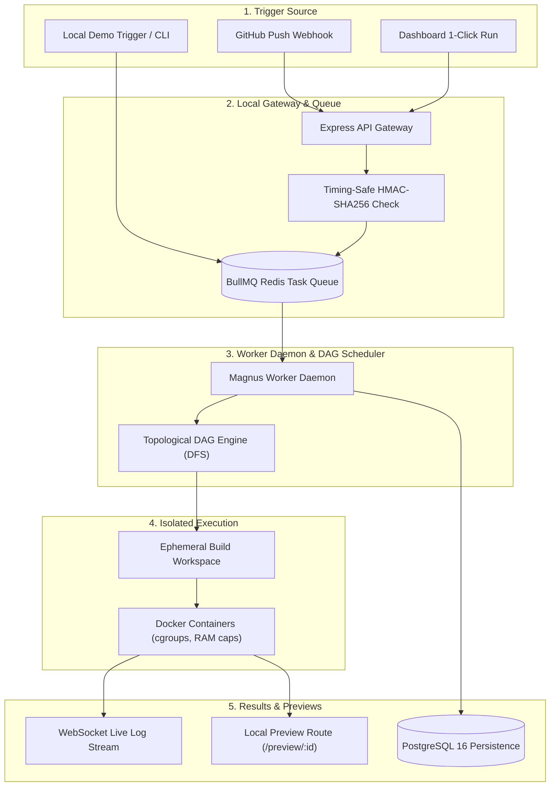

<div align="center">

# MagnusCI

### Ephemeral Container-Native CI/CD Automation Engine

**Automated Pipelines** • **Parallel DAG Scheduling** • **Live Terminal Streaming** • **Local Build Previews** • **Docker Sandboxed Execution**

[View Repository](https://github.com/AmanKashyapp07/ci-cd-engine) · [Localhost Dashboard](http://localhost:5001/ci/) · [Demo Playbook](demo.md)

---

</div>

**MagnusCI** is an automated continuous integration and delivery (CI/CD) engine designed from the ground up for containerized workloads on `localhost`. Think of it as a lightweight, self-hosted alternative to **GitHub Actions** or **GitLab CI** that executes multi-stage pipelines, runs dependency-aware build stages concurrently, streams terminal logs in real time over WebSockets, and serves live web previews of build artifacts directly from a single local server.

On localhost, builds can be triggered via signed GitHub push webhooks (using timing-safe HMAC-SHA256 verification), directly from the React dashboard, or via an offline deterministic demo runner. The engine provisions disposable Docker containers on ephemeral disk or memory workspaces, schedules stages topologically, and exposes real-time logs and build artifacts.

---

## Why I Built This

Modern development teams rely heavily on CI/CD pipelines, but traditional setups frequently suffer from four major pain points:
- **Slow, Serialized Build Queues:** Running build and test steps one-by-one keeps developers waiting and slows down shipping velocity.
- **Dirty Build Runners & Host Disk Fill-Up:** Old build artifacts, unpruned Docker images, and residual files accumulate on runner machines, eventually exhausting disk space.
- **Blind Pull Request Reviews:** Reviewing frontend changes often requires pulling branches locally and running dev servers just to see how the UI looks.
- **Complex, Heavy Infrastructure:** Enterprise CI/CD systems often require heavy distributed dependencies and complicated setup just to test and evaluate locally.

I built MagnusCI to address these challenges with a clean, container-native architecture: parallel execution graphs, disposable sandboxes, automated preview serving, and low-latency log streaming—runnable locally with a single command.

---

## Table of Contents

- [Key Capabilities](#key-capabilities)
- [How It Works (At a Glance)](#how-it-works-at-a-glance)
- [Deep-Dive Engineering Highlights](#deep-dive-engineering-highlights-for-technical-interviewers)
- [Tech Stack](#tech-stack)
- [Local Architecture & Engine Workflow](#local-architecture--engine-workflow)
- [Getting Started (Single-Command Launch)](#getting-started-single-command-launch)
- [Core Engine Verification](#core-engine-verification)
- [Future Roadmap](#future-roadmap)
- [License](#license)

---

## Key Capabilities

### 1. Smart Parallel Pipeline Scheduling (DAG Engine)
Pipelines are defined in a simple `magnus-ci.json` file. The scheduling engine dynamically resolves stage prerequisites, dispatching independent build, lint, and test jobs concurrently to finish pipelines in a fraction of the time required by sequential runners.

### 2. Ephemeral Container Sandboxes
Every build stage executes inside an isolated Docker container mounted onto temporary workspaces. Stages run with strict timeouts, resource constraints, and unprivileged user sandboxing, leaving zero residual containers or processes upon completion.

### 3. Real-Time Terminal Log Streaming
Watch build outputs, compilation warnings, and test results stream live into your browser via WebSockets. The built-in terminal viewer features ANSI color decoding, log filtering, and auto-scrolling.

### 4. Instant Local Build Previews
When a frontend build stage produces web assets (`dist/`, `build/`), MagnusCI automatically serves them on a local preview route (`/preview/:buildId/`). Reviewers can verify UI changes and responsive layouts directly in their browser.

### 5. Dependency Caching
Computes deterministic SHA-256 fingerprints across project lockfiles (`package-lock.json`, `requirements.txt`, `go.sum`). Caches dependency archives to accelerate repeat builds.

### 6. Automated GitHub PR Bot Formatting
Formats rich markdown summaries suitable for GitHub Pull Requests or local inspection, displaying stage runtimes, status badges, error tracebacks, and preview links.

### 7. Self-Healing Auto-Revert Guard
If a commit fails the pipeline, the engine includes logic to inspect failure causes and prepare an automated revert branch, with built-in commit signature detection to prevent recursive webhook triggers.

---

## How It Works (At a Glance)

MagnusCI automates the path from code push to execution and preview in five distinct steps:



1. **Trigger:** A build is initiated via an authenticated GitHub webhook, a local CLI demo command, or the React dashboard.
2. **Verify & Queue:** The Express API Gateway validates cryptographic HMAC-SHA256 signatures before enqueuing the job into a Redis-backed BullMQ priority queue.
3. **Schedule:** The background worker consumes the job, parses `magnus-ci.json`, validates dependency constraints, and detects cycles via DFS.
4. **Execute:** Stages execute inside ephemeral Docker sandboxes with enforced CPU/RAM limits, capturing raw stdout/stderr output.
5. **Deliver:** Logs stream live to the browser via Socket.IO, build records persist in PostgreSQL, and static artifacts are made accessible at local preview routes.

---

## Deep-Dive Engineering Highlights (For Technical Interviewers)

For engineering interviewers and systems reviewers, this section details the underlying algorithms, reliability models, and sandboxing architecture.

<details>
<summary><b>1. DAG Scheduling: DFS Cycle Detection & Dynamic Readiness Frontier (<code>dag.js</code>)</b></summary>
<br/>

* **Cycle Detection with Depth-First Search:** Before executing any container, `hasCycle()` traverses stage dependencies using recursive DFS with active recursion-stack tracking (`visited` and `recStack` sets). Circular definitions (e.g., A depends on B, B depends on A) are rejected in $O(V+E)$ time with descriptive error diagnostics before consuming compute resources.
* **Dynamic Parallel Readiness Frontier:** Rather than using a static topological queue (like Kahn's algorithm) that enforces artificial layer barriers, `executeDAG()` evaluates a dynamic readiness frontier. As stages execute asynchronously, newly unblocked stages whose prerequisites have all reached `SUCCESS` are immediately dispatched concurrently via `Promise.race()`. This maximizes parallelism across stages with unpredictable, variable runtimes.
* **Failure Halting:** If an upstream stage exits with a non-zero code, all downstream dependents are marked as skipped while independent branches continue executing to completion.
</details>

<details>
<summary><b>2. Ephemeral Workspace Allocation (<code>workspaceAllocator.js</code>)</b></summary>
<br/>

* **Isolated Workspaces:** Builds are provisioned in isolated scratch directories (`/tmp/magnus-builds/workspace-${buildId}-${timestamp}` or Linux kernel `/dev/shm`).
* **Atomic Cleanup:** Upon build completion, workspaces are recursively purged. Containers run with forced removal guarantees (`container.remove({ force: true })`) to release system resources immediately.
</details>

<details>
<summary><b>3. Queue Decoupling & Concurrency Controls with BullMQ (<code>queue.js</code> & <code>worker.js</code>)</b></summary>
<br/>

* **Asynchronous Decoupling:** Separates HTTP webhook reception from compute-heavy container execution. The webhook receiver returns an immediate `202 Accepted` response within milliseconds while BullMQ manages worker dispatch.
* **Failure Resilience:** Stalled worker jobs are automatically detected and reclaimed via Redis heartbeat leases. If a worker process exits mid-build, the job transitions cleanly and orphaned containers are reaped.
* **Database Connection Guardrails:** PostgreSQL pool sizing is tuned with statement timeouts and indexed B-Tree lookups on `builds` and `webhook_events` to protect against connection exhaustion under high throughput.
</details>

<details>
<summary><b>4. Container Sandboxing & Security Boundaries</b></summary>
<br/>

* **Docker Socket Isolation:** The host `/var/run/docker.sock` is used exclusively by the trusted backend worker daemon process to manage container lifecycles. Build containers are strictly prohibited from mounting the Docker socket.
* **Execution Sandboxing:** Build containers execute under unprivileged user accounts with dropped Linux capabilities and strict cgroup boundaries (2GB RAM caps, CPU throttles, and PID limits to stop fork bombs).
* **Filesystem & Secret Safety:** Build workspaces are isolated to temporary paths to prevent path traversal attempts (`../../etc/passwd`), and sensitive server environment secrets are stripped before passing environment variables into build containers.
</details>

---

## Tech Stack

| Layer | Technologies |
| :--- | :--- |
| **Frontend UI** | React 19, Tailwind CSS, Vite, Lucide Icons, ANSI terminal stream parser |
| **Gateway & Webhooks** | Node.js, Express, Timing-Safe HMAC-SHA256 (`crypto.timingSafeEqual`) |
| **Task Queue & Event Mesh** | BullMQ, Redis 7 (Pub/Sub & Socket.IO adapter) |
| **Scheduler Engine** | Custom DAG Engine (`dag.js`) with DFS cycle detection and parallel frontier |
| **Container Sandboxing** | Docker Engine API (`dockerode`), Linux cgroup limits, ephemeral workspaces |
| **Database & Persistence** | PostgreSQL 16 (Connection pooling, indexed schema) |
| **Orchestration CLI** | Unified Shell CLI (`start.sh`) with colored output and signal handlers |
| **Engine Verification** | Native Node.js Test Suite (DFS cycle detection, schema validation, HMAC auth) |

---

## Local Architecture & Engine Workflow

MagnusCI runs seamlessly on `localhost` with zero external cloud dependencies:

**Local Dashboard URL:** [http://localhost:5001/ci/](http://localhost:5001/ci/)

- **Unified Single-Port Delivery:** The Express API Gateway routes all API endpoints (`/api/*`), serves compiled React 19 frontend assets (`/ci/`), streams live WebSocket events (`/socket.io`), and hosts preview deployments (`/preview/:id/`).
- **Interviewer Demo Mode:** 1-click **"Interviewer Demo Access"** bypasses external OAuth and logs in directly with preloaded sample workspaces and DAG pipeline execution history.
- **Process Communication:** API Gateway, BullMQ Worker, PostgreSQL 16, and Redis 7 communicate over local loopback interfaces (`127.0.0.1`).

---

## Getting Started (Single-Command Launch)

### Prerequisites
- **Node.js**: v18 or higher
- **Docker Engine**: Docker Desktop or Colima running locally
- **PostgreSQL**: v14 or higher (`brew services start postgresql@14`)
- **Redis**: v7 or higher (`brew services start redis`)

### Quick Setup

Start the entire platform with a single command:

```bash
# Start all local services (Gateway, Worker, Vite HMR proxy, and DB auto-seed)
./start.sh

# Or using npm
npm start
```

### Triggering Builds

- **From Web Dashboard:** Open `http://localhost:5001/ci/`, click **"Interviewer Demo Access"**, and click **[Run]** next to any connected repository.
- **Offline Deterministic Demo (Zero Network Dependency):**
```bash
# Run 4-stage parallel DAG build (setup -> [test, lint] -> package)
npm run demo

# Demonstrate failure handling & automatic downstream skipping
npm run demo:fail
```
- **Simulate Authenticated GitHub Webhook:**
```bash
# Sends an HMAC-SHA256 signed push webhook payload to http://localhost:5001
./start.sh trigger
```

---

## Core Engine Verification

Run the standalone verification suite with zero test runner dependencies:

```bash
# Run core engine checks (DAG DFS cycle detection, pipeline validation, topological scheduling, HMAC verification)
npm test

# Or directly via start.sh:
./start.sh test
```

---

## Future Roadmap

1. **Distributed Worker Nodes:** Scale worker processes across multiple host instances.
2. **Daemonless Container Builds (Kaniko / Rootless):** Eliminate `/var/run/docker.sock` worker requirements by adopting unprivileged rootless container builders.
3. **Artifact Content Deduplication:** Apply cryptographic Merkle DAG content addressing to deduplicate build artifacts across branches.
4. **Interactive Debug Shell:** Provide a one-click terminal session attached to failed build containers for real-time root-cause inspection.

---

## License

This project is licensed under the [MIT License](LICENSE).

<div align="center">

Built and maintained by **Aman Kashyap**  
[GitHub Profile](https://github.com/AmanKashyapp07) · [Report an Issue](https://github.com/AmanKashyapp07/ci-cd-engine/issues)

</div>
